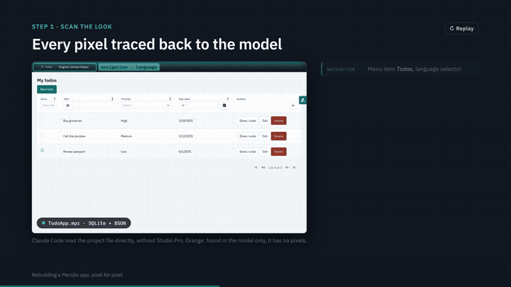

# TodoApp: a Mendix app rebuilt in Next.js, pixel for pixel

This repository holds a small Mendix app, a Next.js rebuild of it, and one
end-to-end test suite that proves the two look and work the same. Claude Code
did the migration: it read the Mendix model, wrote the tests, built the
components and the rebuild, and compared the two apps in CI.

[](slides/deck-video.mp4)

▶ **[Watch the full video](slides/deck-video.mp4)** (2 min, 1080p) ·
open the deck: [`slides/index.html`](slides/index.html), published to GitHub
Pages from the `gh-pages` branch.

| | |
|---|---|
| **85 / 85** | end-to-end tests pass on the Mendix app and on the rebuild: the same tests |
| **17 / 17** | screenshots of the rebuild match Mendix's (CI allows at most 1% of pixels to differ) |
| **0 pixels** | differ between the two apps' todo list and edit popup |

## How it was done

| Step | What happens | Where |
|------|--------------|-------|
| **1. Scan** | Read every page, widget, rule and role from the Mendix project file, and capture every behaviour as a Playwright test that passes on Mendix | [`e2e/`](e2e) |
| **2. Harden** | Run the same tests on the rebuild; diff its DOM and screenshots against Mendix's, fix, push, repeat until both apps pass | [`.github/workflows/e2e.yml`](.github/workflows/e2e.yml) |
| **3. Rebuild** | Next.js with Mendix's own theme compiled in, and React components that render Mendix's markup | [`nextjs/`](nextjs), [`nextjs/packages/atlas-ui/`](nextjs/packages/atlas-ui) |
| **4. Compare** | Every push starts both apps and compares the rebuild's screenshots with Mendix's | [`e2e/README.md`](e2e/README.md#visual-parity) |

## What the app does

Each user keeps their own list of todos. A todo has a title, an optional
description, a due date, a priority (Low, Medium, High) and a done flag. The
home page (`/p/todos`) lists the signed-in user's todos, open ones first, with a
filter on each column. Buttons create, edit and delete a todo, and mark it done
or not done. The `User` and `Administrator` roles can both do all of this, each
on their own todos only.

## What is where

| Path | What |
|------|------|
| [`mendix/`](mendix) | The Mendix 11.16 project, built with [mxcli](https://github.com/mendixlabs/mxcli) instead of Studio Pro |
| [`mendix/mdlsource/01-todo.mdl`](mendix/mdlsource/01-todo.mdl) | Everything the app adds: the `Todo` module, `TodoItem` entity, pages, microflow, security and navigation |
| [`mendix/tests/Todo.test.mdl`](mendix/tests/Todo.test.mdl) | Microflow tests for `Todo.ACT_TodoItem_ToggleDone` |
| [`nextjs/`](nextjs) | The Next.js rebuild ([README](nextjs/README.md)) |
| [`nextjs/packages/atlas-ui/`](nextjs/packages/atlas-ui) | The reusable part: the `atlas-theme` CLI and React components that render Mendix markup ([README](nextjs/packages/atlas-ui/README.md)) |
| [`e2e/`](e2e) | One Playwright suite for both apps: 85 tests in 10 specs, 17 of them screenshots ([README](e2e/README.md)) |
| [`slides/`](slides) | The deck, its preview and the video |
| [`.github/workflows/`](.github/workflows) | `e2e` runs the suite against both apps on every push; `slides` publishes the deck |

## Run it

### The Mendix app

From `mendix/`, download mxcli and start the app:

```bash
cd mendix
curl -fsSL -o ./mxcli https://github.com/mendixlabs/mxcli/releases/download/nightly/mxcli-linux-amd64 && chmod +x ./mxcli
./mxcli run --local --detach --ensure-db -p TodoApp.mpr
```

It serves on http://localhost:8080/. Stop it with `./mxcli run stop -p TodoApp.mpr`.

Sign in as `demo_user` (role `User`) or `demo_administrator` (role
`Administrator`). Mendix generated their passwords and `describe` does not show
them, so set your own, locally:

```bash
./mxcli -p TodoApp.mpr -c "create or modify demo user 'demo_user' ( Password: 'Choose-a-passw0rd', UserRoles: (User) );"
```

Demo users are on at the Production security level. Turn them off before
deploying anywhere real: `alter app security ( EnableDemoUsers: false );`.

### The Next.js rebuild

Node 22.5 or later. From `nextjs/`:

```bash
cd nextjs
npm install
npm run dev
```

It serves on http://localhost:3000/ with the same demo users; their password is
`Choose-a-passw0rd` unless you set `DEMO_PASSWORD`. See
[`nextjs/README.md`](nextjs/README.md) for the production build and settings.

### The end-to-end tests

With an app running, from `e2e/`:

```bash
cd e2e
npm install
npm run test:mendix      # against http://localhost:8080
npm run test:nextjs      # against http://localhost:3000
```

The screenshot baselines must come from Mendix (`npm run baseline:mendix`).
[`e2e/README.md`](e2e/README.md) covers baselines, passwords and CI.

## Change the Mendix app

The app is defined by the MDL script. Check it, apply it, and run the checks
and microflow tests, from `mendix/`:

```bash
./mxcli check mdlsource/01-todo.mdl -p TodoApp.mpr --references
./mxcli exec mdlsource/01-todo.mdl -p TodoApp.mpr
./mxcli docker check -p TodoApp.mpr
./mxcli test tests/ -p TodoApp.mpr --local
```

The project was made with `mxcli new`, stripped of the template's unused
modules, widgets and welcome page, and then had `01-todo.mdl` applied.
Re-running the script must report everything unchanged.

## CI

- **`e2e`** runs on every push except one that only changes the slides. It builds and
  starts the rebuild, starts the Mendix app with mxcli, runs the suite against
  Mendix (whose screenshots become the baselines), then against the rebuild.
  Reports, baselines and both apps' logs are kept as artifacts.
- **`slides`** publishes `slides/` to the `gh-pages` branch when it changes on
  the default branch, or by hand from the Actions tab.

## The deck and the video

[`slides/index.html`](slides/index.html) is a self-contained, seven-slide deck.
Open it in a browser and use the arrow keys. The animated slides replay each
time they are shown.

| File | What |
|------|------|
| [`slides/deck-video.mp4`](slides/deck-video.mp4) | The whole deck as a 2-minute 1080p video |
| [`slides/deck-preview.gif`](slides/deck-preview.gif) | The 27-second preview at the top of this README |
| [`slides/proof/`](slides/proof) | Screenshots of both apps from CI, used on the Compare slide |

The video was recorded from the deck in headless Chromium (Playwright) and
encoded with ffmpeg.
